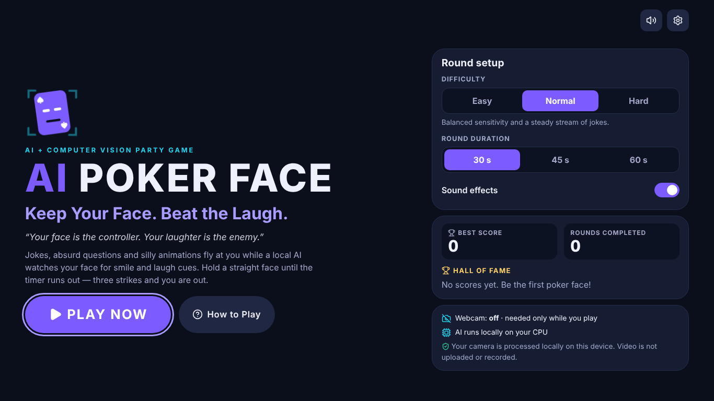

# AI POKER FACE

**Keep Your Face. Beat the Laugh.**
*“Your face is the controller. Your laughter is the enemy.”*

AI Poker Face is a browser party game for AI / computer-vision exhibitions. Jokes,
absurd questions and silly animations appear on screen while a **local, CPU-only**
MediaPipe face model watches the player's facial cues through the webcam. Keep a
straight face until the timer runs out. A sustained laugh-like expression costs a
strike: three strikes and you are out.



- React 19 + TypeScript (strict) + Vite
- MediaPipe Tasks Vision **Face Landmarker** with face blendshapes
- Inference delegate explicitly set to **`CPU`** (WebAssembly + XNNPACK). No GPU, no WebGPU, no CUDA
- Model, WASM runtime, content and sounds are all served from this computer
- No cloud APIs, no API keys, no accounts, no uploads. Plays **offline** after installation

---

## Contents

1. [Requirements](#1-requirements)
2. [Quick start on Windows](#2-quick-start-on-windows)
3. [Installation and AI asset setup](#3-installation-and-ai-asset-setup)
4. [Launching the game](#4-launching-the-game)
5. [How to play](#5-how-to-play)
6. [Webcam troubleshooting](#6-webcam-troubleshooting)
7. [Offline and privacy](#7-offline-and-privacy)
8. [CPU-only architecture](#8-cpu-only-architecture)
9. [How laugh estimation works](#9-how-laugh-estimation-works)
10. [Rules, scoring and difficulty](#10-rules-scoring-and-difficulty)
11. [Project structure](#11-project-structure)
12. [Testing](#12-testing)
13. [Customising](#13-customising)
14. [Known limitations](#14-known-limitations)

---

## 1. Requirements

| | Minimum |
| --- | --- |
| OS | Windows 10/11 (also works on macOS and Linux) |
| Node.js | **22 LTS** recommended (20.19+ works) — <https://nodejs.org> |
| Browser | Recent **Chrome** or **Edge** (Firefox works too) |
| Camera | Any built-in or USB webcam |
| GPU | **Not required.** Everything runs on the CPU |
| Internet | Only once, for `npm install` |

## 2. Quick start on Windows

1. Install Node.js 22 LTS.
2. Download or clone this folder.
3. Double-click **`start-game.bat`**.
   - The first time, it runs `npm install` (needs internet, about a minute).
   - It then starts the local server and opens **<http://localhost:5173>**.
4. Click **PLAY NOW** and allow camera access when the browser asks.

Keep the black console window open while playing; press `Ctrl+C` in it to stop the game.
If anything fails, the window stays open and shows the error.

Prefer the terminal? In PowerShell or Command Prompt inside the project folder:

```powershell
npm install
npm run dev
```

Then open <http://localhost:5173>.

## 3. Installation and AI asset setup

`npm install` installs the packages and then runs `scripts/setup-assets.mjs` automatically
(the `postinstall` script). The script:

1. **Copies the MediaPipe WASM runtime** from `node_modules/@mediapipe/tasks-vision/wasm`
   into **`public/mediapipe/wasm/`** (`vision_wasm_internal.{js,wasm}` and the
   `vision_wasm_nosimd_internal.{js,wasm}` fallback). Copying from the installed package
   guarantees that the WASM matches the JavaScript API version (pinned to `1.1.1`).
2. **Verifies the Face Landmarker model** at **`public/models/face_landmarker.task`**
   (SHA-256 `64184e22…0bc9ff`). The model is included in the repository. If it is
   missing, it is downloaded once from the official MediaPipe model storage:
   `https://storage.googleapis.com/mediapipe-models/face_landmarker/face_landmarker/float16/1/face_landmarker.task`

Useful commands:

| Command | What it does |
| --- | --- |
| `npm run setup-assets` | Re-copy the WASM runtime and restore the model if missing (may download) |
| `npm run verify-assets` | Check the assets without touching the network (also runs before `dev` and `build`) |

Manual model setup (for example on a locked-down machine): download the URL above and
save it as `public/models/face_landmarker.task`, then run `npm run verify-assets`.

## 4. Launching the game

| Command | Purpose | URL |
| --- | --- | --- |
| `npm run dev` | Development server (what `start-game.bat` uses) | <http://localhost:5173> |
| `npm run build` | Type-check and create an optimised build in `dist/` | — |
| `npm run preview` | Serve the production build locally | <http://localhost:4173> |
| `npm run test` | Unit tests (Vitest) | — |
| `npm run typecheck` | TypeScript strict type check | — |

> **Do not open `index.html` by double-clicking it.** Browsers only allow webcam access
> on `http://localhost` or HTTPS pages, and the WASM/model files must be served over HTTP.
> Always use one of the localhost URLs above.

## 5. How to play

1. **Home**: choose difficulty (Easy / Normal / Hard), round length (30 / 45 / 60 s) and sound, then press **PLAY NOW**.
2. **Camera check**: the game loads the local AI model and asks for the webcam. It shows real
   status for the model, the camera and your face, plus tips if the image is too dark or your
   face is too far, too close or off-centre. You can type an optional nickname.
   **Continue** unlocks only when the model, the camera and a face are all ready.
3. **Calibration**: relax and look at the camera for about two seconds. The game measures
   your *neutral* facial cues so a naturally smiley resting face is not punished. If you
   smiled during calibration you can recalibrate. Then: **3 → 2 → 1 → START!**
4. **Play**: keep a straight face. The **AI laugh estimation** meter shows
   *Calm → Suspicious Smile → High Risk → Laugh-Like Event Detected*. A sustained
   laugh-like expression costs a strike (−20). Three strikes end the round early.
   Hiding your face pauses the timer.
5. **Results**: final score, time survived, laugh-like events, survival, best score and a
   title (*Poker Face Legend*, *Ice-Cold Champion*, *Almost Lost It*, *Laugh Detected!*,
   *Challenge Failed*). Save a Top 10 score with a nickname, then **PLAY AGAIN**,
   **NEXT PLAYER** (re-runs the camera check and calibration) or **HOME**.
6. **Top 10 leaderboard**: open it with *View Top 10* from the Leaderboard card on Home or on
   the results screen. It lists rank, player, score, difficulty, round length, laugh-like events,
   result title and time for the ten best scores on this computer; the latest saved score is highlighted.

Keyboard: `Space`/`P` pause and resume, `Esc` pause, `M` mute, `Shift`+`D` developer diagnostics.

## 6. Webcam troubleshooting

| Problem | Fix |
| --- | --- |
| **"Camera access denied"** | Click the camera icon in the address bar and choose *Allow*, then **Try again**. On Windows also check *Settings → Privacy & security → Camera*: camera access, *Let apps access your camera* and *Let desktop apps access your camera* must be **On**. |
| **"Camera is busy"** | Close Teams, Zoom, the Windows Camera app, OBS or other browser tabs that use the webcam, then **Try again**. |
| **"No webcam found"** | Plug in or enable the webcam (some laptops have a privacy switch or Fn key). |
| **"Webcam disconnected"** mid-game | The round pauses. Reconnect the camera and press **Restart camera**, then **Resume**. |
| **"Camera blocked on this address"** | You opened the game from a file or a network IP. Use <http://localhost:5173>. |
| **"Model could not load" / "AI runtime files missing"** | Run `npm run setup-assets`, then restart with `npm run dev`. |
| "No face detected" | Face the camera, move closer, and add light in front of you (not behind you). |
| Strikes without laughing | Open **Settings** and lower *Detection sensitivity*, re-calibrate with a relaxed face, or choose Easy. Beards, glasses and dim light can shift facial cues. |
| Never detects laughing | Raise *Detection sensitivity* or choose Hard. Make sure the face overlay tracks your mouth. |
| Low FPS on a slow laptop | Close other heavy apps. The game automatically lowers the AI frame rate (down to 6 fps) to keep play smooth; it never switches to the GPU. |

To switch the camera off at any time, use **Camera on · Stop** in the top bar or *Settings → Stop camera*.
The camera also stops on the home screen and when the tab is closed.

## 7. Offline and privacy

- **Video never leaves the browser tab.** Frames are read from a local `<video>` element and
  analysed in memory by the WASM runtime. Nothing is uploaded, recorded or saved.
- **No face data is stored.** Landmarks and expression values live only in memory for the
  current frame. LocalStorage holds only settings, nicknames and scores.
- **No facial identification, no accounts, no analytics.**
- **No runtime network access.** All assets come from `localhost`. Two layers enforce it:
  1. A **Content-Security-Policy** (`connect-src 'self'`, set in `vite.config.ts` as both a
     response header and a `<meta>` tag) makes the browser refuse any connection to another origin.
  2. A **local-only fetch guard** (`src/privacy/networkGuard.ts`) rejects cross-origin requests.
     This matters because MediaPipe Tasks 1.1.x contains a built-in usage logger that tries
     to POST task statistics (task type, platform, latency; no images) to a Google endpoint
     about once a minute and has no public opt-out. The game blocks it, and the browser
     console shows `Blocked outbound request to https://odml.pa.googleapis.com/v1/log`.
- After `npm install` the game was verified to run a full round with all non-localhost name
  resolution blocked.

## 8. CPU-only architecture

```
 Webcam ─► getUserMedia (640×480, video only)
             │
             ▼
   one shared <video> element ──► CameraPreview (mirrored display + landmark overlay canvas)
             │
             ▼  requestAnimationFrame, new frames only, throttled to ≤15 fps (adaptive, min 6)
   FaceLandmarker.detectForVideo()   ◄── /models/face_landmarker.task (local)
     delegate: "CPU"  (WASM + XNNPACK) ◄── /mediapipe/wasm/vision_wasm_internal.* (local)
             │  52 blendshapes + 478 landmarks (in memory only)
             ▼
   blendshapeAnalyzer ─► calibration baseline ─► laughEstimator (pure, unit-tested)
             │                                        │ laugh-like event
             ▼                                        ▼
   CueMeter / diagnostics (direct DOM updates)   gameEngine (pure, unit-tested) ─► HUD / results
```

- **CPU delegate:** `src/vision/faceLandmarker.ts` creates the landmarker with
  `baseOptions: { delegate: 'CPU' }`, `runningMode: 'VIDEO'`, `numFaces: 1`,
  `outputFaceBlendshapes: true`. MediaPipe confirms it in the console with
  `INFO: Created TensorFlow Lite XNNPACK delegate for CPU.` (MediaPipe prints this
  through `console.error`, but it is informational, not an error). Difficulty never
  changes the delegate.
- **WASM:** SIMD build by default, with automatic fallback to the no-SIMD build on old CPUs.
- **One inference loop:** `visionService` owns a single `FaceTracker`. Frames are only
  processed when `video.currentTime` changes, timestamps are strictly increasing, and the rate
  drops automatically if inference averages more than 60 % of the frame budget.
- **No per-frame React renders:** the meter and overlay subscribe to frames and update the DOM
  directly. React state changes only when visible values change (about 10×/s for the timer).
- **Cleanup:** tracks are stopped on the home screen, on *Stop camera* and on `pagehide`. The
  landmarker is closed on page unload. Animation loops and subscriptions are released on unmount.
- The *Developer diagnostics* panel (`Shift`+`D`) shows live values: model status, delegate,
  WASM variant, load time, camera resolution, inference FPS and time, face presence, smile /
  jaw-open / cheek-squint cues, smoothed score, sustain progress and detection state.

Measured in this project's headless Chromium test environment (no GPU): about **15 inference
fps at 20–30 ms per frame**, with the model loading in under a second. Real laptops vary.

## 9. How laugh estimation works

MediaPipe blendshapes describe **facial movements**, not emotions. A high `mouthSmile` value
means the mouth corners are raised, not that the player is amused. The game therefore calls
this feature **AI laugh estimation** and treats it as a game mechanic.

Per frame (`src/vision/blendshapeAnalyzer.ts`, `src/vision/laughEstimator.ts`):

1. **Cues:** `smile` = mean of `mouthSmileLeft` and `mouthSmileRight`; `jawOpen`;
   `cheekSquint` = mean of `cheekSquintLeft` and `cheekSquintRight`. Frames without
   the required blendshapes are treated as *no face*, never as a neutral face.
2. **Baseline:** calibration takes the median of about 2 s of neutral samples per cue, capped
   at 0.4 so a smiling calibration cannot blind the detector. Each cue is rescaled so the
   baseline maps to 0: `(value − baseline) / (1 − baseline)`.
3. **Weighted score:** `0.60·smile + gate·(0.25·jawOpen + 0.15·cheekSquint)`, where
   `gate = min(1, smile / 0.35)`. Talking, yawning or squinting without a smile cannot score.
4. **Smoothing:** time-based exponential smoothing (τ = 160 ms).
5. **Sustain:** the smoothed score must stay above the trigger threshold for the difficulty's
   sustain time. Dips into the hysteresis band drain progress slowly, and a drop below the
   reset threshold clears it. Single frames can never trigger.
6. **One strike per laugh:** after an event the detector disarms until the score falls below
   the reset threshold, and a cooldown blocks further events. One long laugh is one strike.
7. **Tracking gaps:** gaps up to 600 ms keep the state; longer gaps reset it. During play,
   a face missing for more than 1.5 s pauses the round, which resumes once the face is back.

## 10. Rules, scoring and difficulty

`Final Score = max(0, Starting Score − Penalties + Survival Bonus)`

| Rule | Default |
| --- | --- |
| Starting score | 100 |
| Penalty per laugh-like event | −20 |
| Strikes that end the round | 3 |
| Survival bonus (full timer only) | +30 |
| Round length | 30 s (45 / 60 selectable) |

| Difficulty | Trigger / reset threshold | Sustain | Cooldown | Challenge change | Content |
| --- | --- | --- | --- | --- | --- |
| Easy | 0.56 / 0.34 | 0.9 s | 2.5 s | every 7.5 s | gentle |
| Normal | 0.46 / 0.28 | 0.6 s | 2.0 s | every 6 s | all |
| Hard | 0.38 / 0.23 | 0.4 s | 1.6 s | every 4.5 s | regular + hard-hitting |

The *Detection sensitivity* slider (1–10, default 5) scales the thresholds by 6 % per step.

Results titles come from what actually happened: 0 strikes → *Poker Face Legend*,
1 → *Ice-Cold Champion*, 2 → *Almost Lost It*; knocked out after half time → *Laugh Detected!*,
before → *Challenge Failed*.

## 11. Project structure

```
├─ start-game.bat              Windows launcher
├─ scripts/setup-assets.mjs    Copies WASM, verifies/downloads the model
├─ public/
│  ├─ models/face_landmarker.task     Local Face Landmarker model (+ README with checksum)
│  └─ mediapipe/wasm/                 Local WASM runtime (generated by setup-assets, git-ignored)
├─ docs/manual-webcam-tests.md  Manual test checklist for a real webcam
└─ src/
   ├─ App.tsx, main.tsx         Screen flow, settings, persistence, shortcuts
   ├─ pages/                    HomePage, CameraSetupPage, CalibrationPage, GamePage, ResultsPage
   ├─ components/               GameHeader, CameraPreview, GameHUD, CueMeter, ChallengeCard,
   │                            VisualGag, ScoreDisplay, CountdownOverlay, SettingsPanel,
   │                            DiagnosticsPanel, HowToPlay, LeaderboardPanel, Modal, …
   ├─ vision/                   faceLandmarker (CPU setup), camera, faceTracker (inference loop),
   │                            visionService, blendshapeAnalyzer, calibration, laughEstimator,
   │                            laughMonitor, faceGeometry, overlayRenderer, visionErrors
   ├─ game/                     gameConfig (all tunables), gameEngine, scoring, gameTypes
   ├─ content/                  challenges (66 original entries), challengeDeck (no-repeat shuffle)
   ├─ hooks/                    useCamera, useFaceTracking, useGameSession
   ├─ storage/                  safeStorage, settings, leaderboard
   ├─ privacy/networkGuard.ts   Local-only fetch guard
   ├─ audio/soundEngine.ts      Web Audio synthesiser (no sound files)
   └─ styles/                   Design tokens and screen styles (system fonts only)
```

## 12. Testing

```powershell
npm run test        # 72 unit tests
npm run typecheck   # TypeScript strict mode
npm run build       # type-check + production build
```

Unit tests use realistic synthetic blendshape values and cover:
scoring, negative-score prevention, the survival-bonus condition, round completion, three-strike
game over, pause and auto-resume rules, detection thresholds, difficulty and sensitivity,
the sustained-expression requirement, one strike per continuous laugh (hysteresis), cooldowns,
missing and interrupted face results, calibration baselines (including smiling calibrations),
camera error mapping, lighting and position guidance, settings and leaderboard validation,
unavailable LocalStorage, the challenge library and deck, and the network guard.

Real-webcam checks are manual and listed in [`docs/manual-webcam-tests.md`](docs/manual-webcam-tests.md).

## 13. Customising

- **Tuning:** every threshold, weight, timing and score lives in `src/game/gameConfig.ts`.
- **Jokes:** add entries to `src/content/challenges.ts` (unique `id`, `category`, `intensity` 1–3,
  `text`, optional `punchline` / `emoji` / `visual`). Visual gags are SVG scenes in
  `src/components/VisualGag.tsx`.
- **Reset the leaderboard:** *Settings → Clear leaderboard & stats*.

## 14. Known limitations

- Facial blendshapes are **cues, not emotions**. A broad grin can count as a laugh-like event,
  and a silent giggle with little mouth movement can slip through. Thresholds are configurable.
- Accuracy drops with poor lighting, strong backlight, heavy occlusion (hands, masks), extreme
  head angles, or several faces in view (only one face is tracked).
- The default thresholds were tuned with synthetic unit-test data and an automated browser run
  that fed still photos through a fake webcam. **They have not yet been tuned with live players
  on a physical webcam.** Run the manual checklist at your venue and adjust *Detection
  sensitivity* if needed.
- CPU performance depends on the laptop. Very old CPUs without WASM SIMD use the slower
  fallback, and the game lowers the inference rate accordingly.
- Scores are stored per browser and per computer (LocalStorage). There is no online leaderboard,
  by design.
- Webcam access requires `localhost` or HTTPS. Serving the game to other devices on a LAN
  would need HTTPS, which is not set up.
